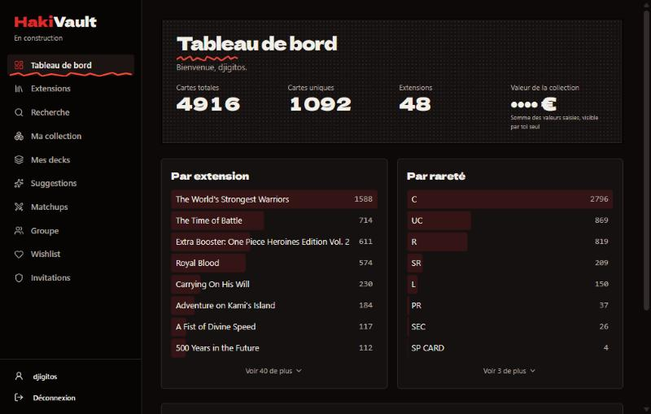
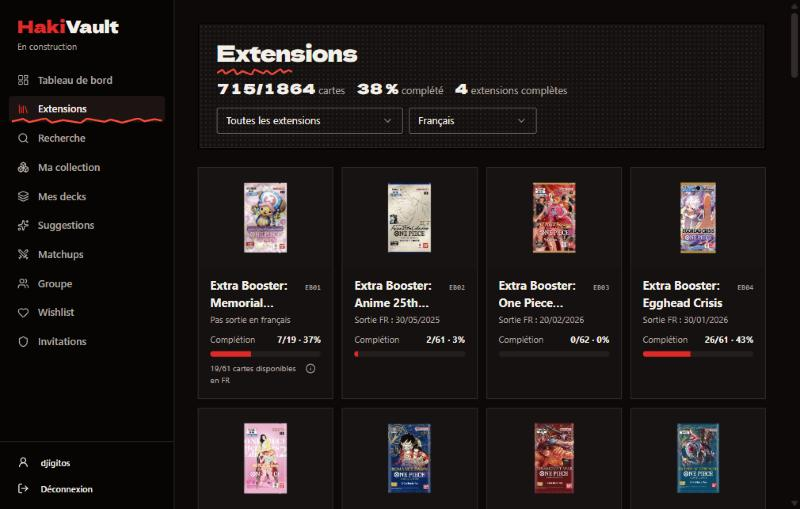
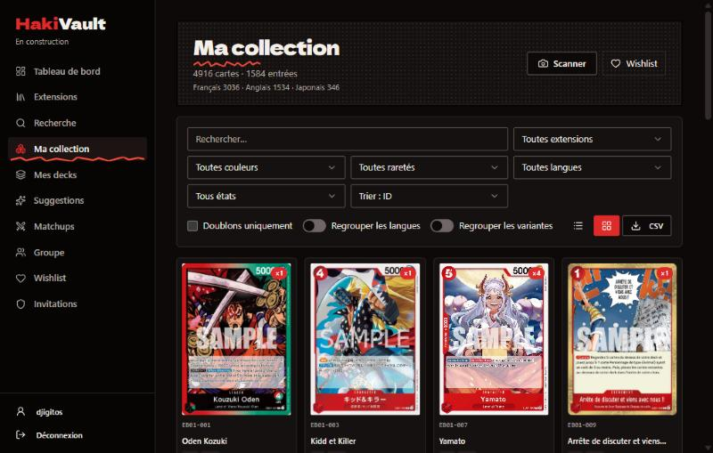
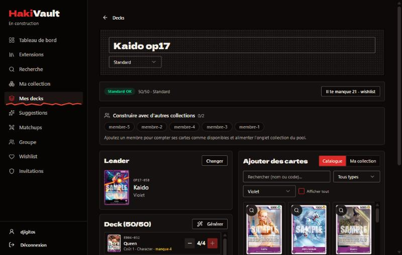
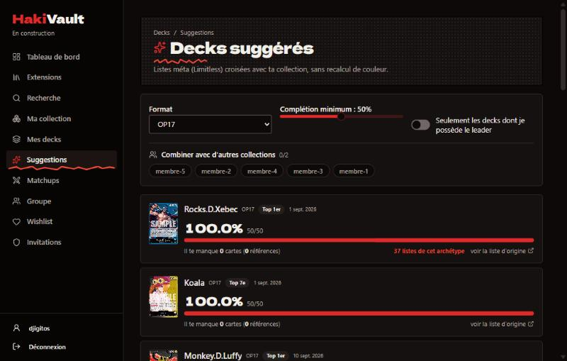
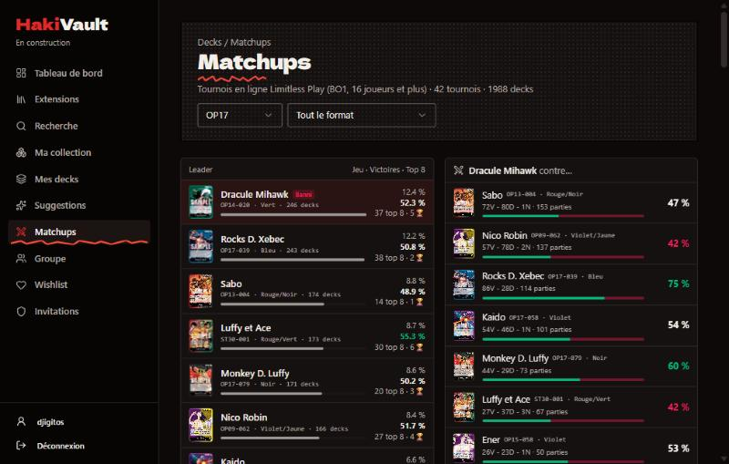
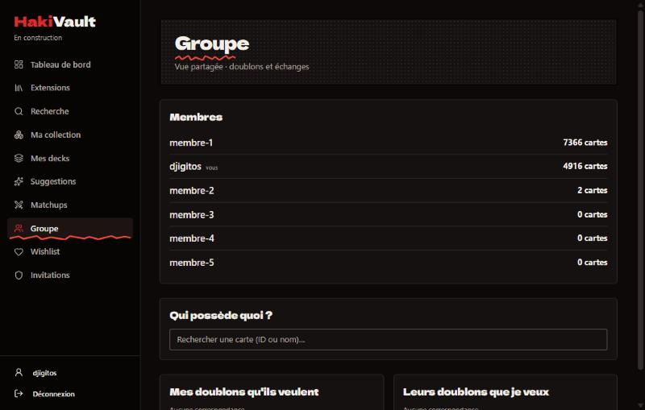
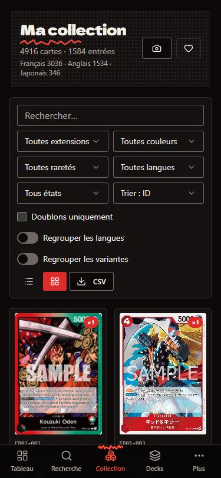

<h1 align="center">HakiVault</h1>

<p align="center">
  <strong>Gérer sa collection One Piece TCG, la comparer à celle de son groupe et en tirer des decks jouables.</strong><br />
  <em>A collection manager and deck-building companion for the One Piece Card Game, built with TanStack Start, React 19 and Supabase.</em>
</p>

<p align="center">
  
</p>

> **Projet personnel, en production** : [hakivault.vercel.app](https://hakivault.vercel.app).
> L'inscription se fait sur invitation (groupe privé d'amis), les écrans ci-dessous servent donc de démonstration.
> Ce dépôt est une **vitrine** : le code source est privé et peut être partagé sur demande.
> HakiVault est un outil de fans : One Piece et le One Piece Card Game appartiennent à leurs ayants droit, le projet n'est pas un produit officiel.

---

## Pourquoi ce projet

Les outils existants ne font qu'une partie du travail : suivre une collection, ou construire un deck, ou consulter la méta. HakiVault les réunit autour d'une idée : **chaque écran relie ce que l'on possède à une action** (compléter une extension, échanger, jouer).

Un membre doit pouvoir savoir à tout moment :

- ce qu'il possède, jusqu'à la **variante et la langue** (FR / EN / JP) ;
- ce qui lui manque pour compléter une extension ;
- **qui, dans son groupe, peut le lui fournir** et ce que les autres recherchent ;
- quels decks il peut jouer **avec les cartes qu'il a déjà**.

## Fonctionnalités

### Collection et extensions

| | |
| --- | --- |
| **Collection détaillée** | Cartes enregistrées par variante (normale, alternative, promo…), langue et état, avec quantités. Filtres par extension, couleur, rareté, langue, état ; tri ; mode liste ou grille ; vue « doublons uniquement » ; regroupement par langue ou par variante ; **export CSV**. |
| **Suivi de complétion** | Progression par extension (X/Y cartes, pourcentage) selon la langue choisie, avec date de sortie FR et distinction des cartes réellement disponibles en français. |
| **Recherche** | Par identifiant (`OP01-001`), par nom ou par extension, avec filtres couleur, rareté, type et langue de l'image. |
| **Scan de cartes** | Ajout par photo : un endpoint serveur authentifié envoie l'image à un modèle de vision (Gemini) avec une sortie structurée, puis rapproche le résultat de la base. |
| **Wishlist** | Cartes recherchées avec quantité, variante et prix maximum. Les liens de prix renvoient vers Cardmarket. |
| **Valeur de la collection** | Les valeurs saisies sont **privées** : visibles uniquement par leur propriétaire (contrôlé côté base). |

<p align="center">
  
  
</p>

### Decks et compétitif

| | |
| --- | --- |
| **Éditeur de decks** | Choix du leader, ajout depuis le catalogue ou depuis sa collection, compteur 50/50, export texte, duplication. Les cartes manquantes alimentent la wishlist en un clic. |
| **Validation des règles** | Format **Standard** ou **Eternal**, limite de copies par carte (y compris les cartes sans limite), compatibilité des couleurs avec le leader, **banlist** et **rotation** par bloc. Un badge indique si le deck est légal. |
| **Générateur** | Complète un deck à partir d'un leader en tenant compte des règles et de la collection. |
| **Decks suggérés** | Listes de tournoi (top 8 Limitless Play) croisées avec la collection : pourcentage de complétion, cartes manquantes, filtre « leader possédé ». Possibilité de **combiner la collection d'autres membres** pour voir ce qui serait jouable à plusieurs. |
| **Matchups** | Statistiques issues des tournois en ligne : taux de jeu, de victoire et de top 8 par leader, puis résultats leader contre leader. Les leaders bannis sont signalés. |

<p align="center">
  
  
</p>

<p align="center">
  
</p>

### Groupe et échanges

- **Vue partagée** des membres et de leurs collections ;
- « **Qui possède quoi ?** » : recherche d'une carte parmi tout le groupe ;
- correspondances d'échange : *mes doublons qu'ils veulent* / *leurs doublons que je veux* ;
- profils de membres ;
- inscription par **code d'invitation à usage unique** (valable 14 jours), gérée depuis un espace admin.

<p align="center">
  
</p>

### Mobile d'abord

L'app s'utilise autant en boutique ou en tournoi (consulter, scanner pendant un échange) qu'au bureau. Sur mobile, la navigation passe en barre d'onglets en bas d'écran, les filtres se replient et les zones tactiles sont dimensionnées pour le doigt. Une passe d'audit d'accessibilité (contrastes, noms accessibles, contours de focus, zoom) a été menée et corrigée.

<p align="center">
  
</p>

> Les captures sont issues de l'application déployée ; les pseudos des autres membres et les valeurs privées ont été masqués. Les cartes « SAMPLE » sont les visuels fournis par les sources officielles.

## Stack technique

| Couche | Choix |
| --- | --- |
| Front | **React 19**, **TanStack Start** (SSR) + **TanStack Router** (routes par fichiers), **TanStack Query** |
| UI | **Tailwind CSS 4**, composants **Radix UI** / shadcn, `lucide-react`, `sonner` |
| Données | **Supabase** (PostgreSQL, Auth, Row Level Security), migrations SQL versionnées |
| Serveur | Routes serveur TanStack Start (`/api/recognize-card`, proxy d'images), authentification vérifiée côté serveur |
| IA | Google **Gemini** (reconnaissance de cartes, sortie JSON structurée) |
| Ingestion | Scripts **Python** (scrapers des sites officiels FR / JP / EN, import Limitless Play, stockage des images sur un bucket compatible S3 / Cloudflare R2) |
| Qualité | **TypeScript**, ESLint + Prettier, **Vitest** + Testing Library |
| CI / déploiement | **GitHub Actions** (import Limitless planifié) · **Vercel** |

## Architecture et choix notables

```
src/
├── routes/            Routes par fichiers (dashboard, collection, decks, matchups, groupe…)
│   └── api/           Endpoints serveur (scan de carte, proxy d'images)
├── components/
│   ├── hakivault/     Composants métier (CardTile, CardDetailSheet, scanner, éditeur de deck…)
│   └── ui/            Primitives Radix / shadcn
├── lib/hakivault/     Logique métier pure et testée : règles de deck, banlist/rotation,
│                      générateur, complétion d'extension, recherche, variantes
├── lib/server/        Garde d'authentification côté serveur
└── integrations/      Client Supabase typé
scripts/               Ingestion Python : scrapers officiels, import Limitless, audits de données
supabase/migrations/   Schéma, fonctions SQL, politiques RLS
```

- **La précision des données avant tout.** Distinguer une variante ou une langue demande une base exacte : les cartes, parallèles, promos et produits sont alimentés par des scrapers des sources officielles, avec des scripts d'audit de couverture et de nettoyage (variantes fantômes, images orphelines).
- **Logique métier isolée de l'UI.** Les règles de construction de deck, la rotation, la complétion et la recherche vivent dans `src/lib/hakivault` en fonctions pures, couvertes par des tests unitaires.
- **Sécurité traitée dans la base.** Politiques RLS, valeurs de collection privées, verrouillage du rôle `anon`, invitations validées en base, fonctions SQL pour les statistiques (voir les migrations `security_hardening`, `private_card_values`). Le scanner exige un utilisateur authentifié avant tout appel au modèle.
- **Données de méta automatisées.** Un workflow GitHub Actions importe les tournois Limitless Play deux fois par semaine, puis promeut les decks du top 8 vers les suggestions.
- **Direction visuelle assumée.** Interface sombre inspirée d'une planche de manga (encre, trame, rouge « haki »), typographie Dela Gothic One. Le système de design (couleurs, typographie, composants) et la vision produit sont documentés dans le dépôt de code.

## Ce que ce projet démontre

- Concevoir un produit de bout en bout : besoin utilisateur, modèle de données, interface, déploiement.
- Modéliser un domaine riche (extensions, variantes, langues, produits, decks, tournois) en SQL, avec migrations versionnées.
- Écrire des règles métier non triviales (légalité d'un deck, rotation, copies maximales) isolées et testées.
- Construire un pipeline de données fiable : scraping, déduplication, audits, import planifié.
- Intégrer un modèle de vision de façon sûre (authentification, sortie structurée, validation).
- Soigner l'accessibilité et l'usage mobile, pas seulement le rendu bureau.

## Statut

Projet vivant, utilisé par un groupe de joueurs. Le code source est disponible sur demande. L'ouverture publique (inscription libre, plusieurs groupes) n'est pas encore décidée.
